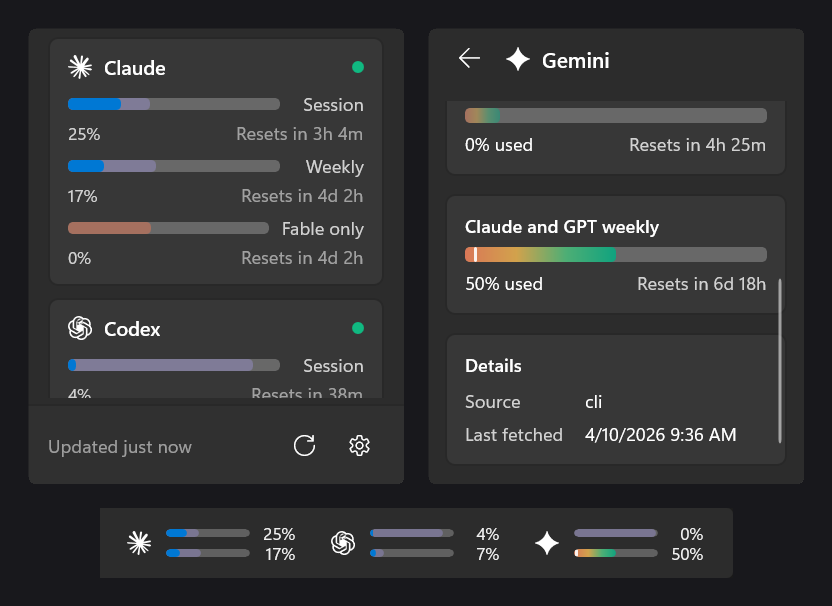
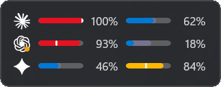
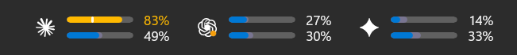
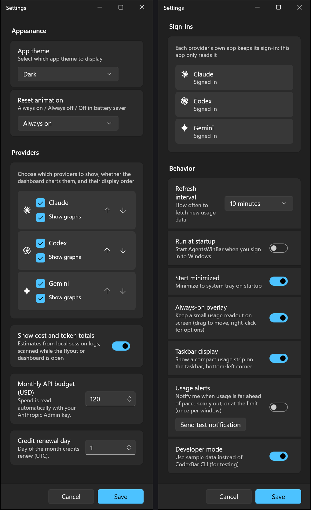
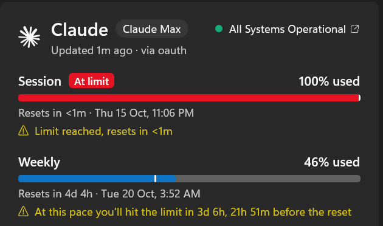
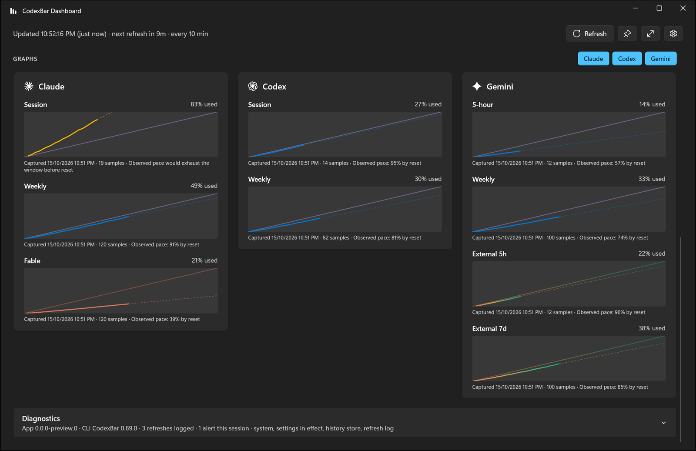

# AgentsWinBar

**See how much of your Claude, Codex and Gemini limits you have left, without opening anything.**

A Windows 11 app that puts your AI coding usage on the desktop: a tray flyout, an always-on floating readout, a strip that sits on the taskbar, and a full dashboard that shows every limit at once. It reads the numbers from the [CodexBar CLI](https://github.com/steipete/CodexBar) running in WSL.

This is the Wave-OCE fork of [nek0der/CodexBarWin](https://github.com/nek0der/CodexBarWin), which is the Windows front end for [steipete/CodexBar](https://github.com/steipete/CodexBar). What changed in the fork is [listed below](#what-this-fork-adds).

## Install

Tell your AI coding agent: `Install AgentsWinBar from https://github.com/thomasyuxizeng/AgentsWinBar — follow INSTALL.md`. Or run `powershell -ExecutionPolicy Bypass -File install.ps1` from a clone. See [INSTALL.md](INSTALL.md) for commands and exit codes.

[](LICENSE.txt)
[](https://dotnet.microsoft.com/)
[](https://microsoft.github.io/microsoft-ui-xaml/)




*Left: the tray flyout. Right: a provider's detail page (Gemini, with a usage history chart for each window). Bottom: the taskbar strip.*


*The dashboard, described under [The dashboard](#the-dashboard): a needs-attention summary, one panel per provider and a graphs section. This one sample shows most of what the app can say at once: Claude's session is at its limit during a major outage, Codex's session is at 93% and running ahead of pace during a minor incident, Gemini's external 7-day window is near its limit, the other bars are comfortably behind pace, and the API credits are running low. Every screenshot and animation in this README uses the app's developer-mode sample data, not real usage.*

When a limit resets, its bar plays a short animation (see [Reset animation](#reset-animation)). Here it is on the floating overlay:



## Contents

- [What you get](#what-you-get)
- [Quick start](#quick-start)
- [Reading the bars](#reading-the-bars)
- [The dashboard](#the-dashboard)
- [What this fork adds](#what-this-fork-adds)
- [How it works](#how-it-works)
- [Troubleshooting](#troubleshooting)
- [Configuration](#configuration)
- [Development](#development)

## What you get

| | |
|---|---|
| **Flyout** | Click the tray icon (or the strip, or the overlay) for a card per provider: session, weekly and extra windows, with exact reset times. Click a card for its detail page. |
| **Dashboard** | A full, resizable window (full screen with F11, optional keep-on-top) opened from the button in the flyout footer. See [The dashboard](#the-dashboard). |
| **Taskbar strip** | A compact, borderless strip flush with the left end of the taskbar: provider logo plus two bars each. Always visible, never takes focus. |
| **Floating overlay** | The same readout as a small draggable window that stays above your apps. Position is remembered. |
| **Usage alerts** | Windows notifications when you're burning through a limit too fast, nearly out, or out. |
| **Pace awareness** | Every bar also shows how much of the window's time has passed, so you can tell "50% used" at the start of a window from "50% used" near the end. |
| **Provider status** | Service health on each card, incident details with a status-page link, and a small incident dot on compact displays. Grey means no status is available (including Gemini through Antigravity). |
| **Cost and tokens** | Today's and last-30-days totals from local logs, each on its own wrapping card line. Detail pages show daily costs and top models. Amounts are list-price estimates, not bills. |
| **Usage history** | Detail pages plot each limit window's usage against an even-use guide readable in light and dark themes, with a projection from the observed rate and local capture times. History builds as the app runs and is kept for 14 days. The dashboard's [GRAPHS](#the-dashboard) section shows compact versions of these charts. |
| **API credits** | The dashboard's Claude panel can show your Anthropic organization's API spend against a monthly budget. Needs an Anthropic Admin key. See [API credits](#api-credits). |
| **Gemini API spend** | The dashboard's Gemini panel can show this month's Gemini API spend from a local spend log, by route and by model. See [Gemini API spend](#gemini-api-spend). |

Supported providers: **Claude**, **Codex** (OpenAI) and **Gemini** (read through Google's Antigravity).

The two compact displays, which you can run together or separately:

| Floating overlay | Taskbar strip |
|:---:|:---:|
|  |  |
| Rows are Claude, Codex and Gemini; each row shows two bars. | The same readout laid out along the taskbar. |

## Quick start

`install.ps1` automates steps 1–4 below; see [INSTALL.md](INSTALL.md).

You need about 15 minutes the first time. The app runs on Windows; the usage data comes from a small tool inside WSL, so there are three parts: WSL, sign-ins, then the app.

### 1. Prerequisites

- **Windows 11.** The app is built and tested on it; the taskbar strip and Mica backdrop are designed for it.
- **WSL 2 with Ubuntu.** From an administrator PowerShell: `wsl --install -d Ubuntu-24.04`, then restart. If that fails, see [WSL won't install](#wsl-wont-install).
- To build the app yourself you also need the **.NET 10 SDK**. If you install a prebuilt package you don't.

### 2. Set up the CLI inside WSL

Clone this repo, then from PowerShell in `tools\wsl`:

```powershell
git clone https://github.com/thomasyuxizeng/AgentsWinBar.git
cd AgentsWinBar\tools\wsl
.\install-wsl-shim.ps1 -Distro Ubuntu-24.04
```

This downloads the CodexBar CLI (checksum verified), installs it in `/opt/codexbar`, and installs a small wrapper (the "shim") that makes Claude and Gemini work reliably. Details in [tools/wsl/README.md](tools/wsl/README.md).

### 3. Sign in to each provider (once, inside WSL)

Open a WSL shell (`wsl -d Ubuntu-24.04`) and sign in to the providers you use:

| Provider | Steps |
|----------|-------|
| **Claude** | Run `claude` and log in with your Claude account. |
| **Codex** | `npm install -g @openai/codex`, then `codex login` (use `codex login --device-auth` if the browser redirect doesn't reach WSL). It needs its own Linux copy; a Windows `codex` can't run in WSL. |
| **Gemini** | `curl -fsSL https://antigravity.google/cli/install.sh \| bash`, run `agy` once and sign in with Google, then exit straight away (it is an agent and will act on anything you type). |

Check that it works: `wsl -d Ubuntu-24.04 codexbar usage --provider claude --format json` should print JSON.

### 4. Install the app

The app is a signed MSIX package. The signature is self-signed, so Windows needs to trust the certificate once.

**From a release** (when one is published):

```powershell
gh release download --repo thomasyuxizeng/AgentsWinBar --pattern "*.msix" --pattern "*.cer"

# Trust the certificate (administrator PowerShell)
Import-Certificate -FilePath .\AgentsWinBar-v*-Certificate.cer -CertStoreLocation Cert:\LocalMachine\TrustedPeople

# Install
Add-AppxPackage .\AgentsWinBar-v*-x64.msix
```

Releases no longer include `CodexBarWin.appinstaller`. If you have one from an older release, don't use it: it points at the upstream project's releases and would install (and keep updating to) the upstream app, without the changes listed below.

**From source:**

```powershell
# One-time: a signing certificate whose subject matches the manifest publisher
$cert = New-SelfSignedCertificate -Type CodeSigningCert -Subject "CN=CodexBarWin OSS" `
  -KeyUsage DigitalSignature -CertStoreLocation Cert:\CurrentUser\My `
  -TextExtension @("2.5.29.37={text}1.3.6.1.5.5.7.3.3", "2.5.29.19={text}")
Export-Certificate -Cert $cert -FilePath AgentsWinBar.cer
Import-Certificate -FilePath AgentsWinBar.cer -CertStoreLocation Cert:\LocalMachine\TrustedPeople   # admin

# Build the package, sign it, install it
# First set Identity Version in Package.appxmanifest to your chosen version, e.g. 0.9.6.0
dotnet build AgentsWinBar.csproj -c Release -p:Platform=x64 -p:UapAppxPackageBuildMode=SideloadOnly `
  -p:AppxBundle=Never -p:AppxPackageDir="AppPackages\" -p:AppxPackageSigningEnabled=false `
  -p:GenerateAppxPackageOnBuild=true -p:PublishReadyToRun=false
signtool sign /fd SHA256 /sha1 $cert.Thumbprint (Get-ChildItem AppPackages -Filter *.msix -Recurse).FullName
Add-AppxPackage (Get-ChildItem AppPackages -Filter *.msix -Recurse).FullName
```

`signtool` ships with the Windows SDK. Increase the manifest's Identity Version for each build so Windows
treats it as an update; `AppxVersion` alone did not override the manifest in the tested .NET SDK build.
Choose the MSIX for that version when signing and installing if `AppPackages` contains older builds.
The packaged app keeps its settings across updates.

> **Running an unsigned build** (`dotnet run`, or the exe from `bin\`) is blocked on machines with Smart App Control or App Control for Business enabled. Install the signed package instead.

### 5. Use it

1. Launch **AgentsWinBar** from the Start menu. It lives in the system tray (it may be under the `^` overflow).
2. Click the tray icon for the flyout. Click a provider card for details, the gear for **Settings**, or the dashboard button in the footer for the [full dashboard](#the-dashboard).
3. In **Settings**, turn on what you want:



*Settings at two scroll positions: Reset animation under Appearance, then Monthly API budget and Credit renewal day.*

| Setting | What it does |
|---------|--------------|
| Providers | Choose which providers show, and their order. Each provider also has a **Show graphs** checkbox (on by default) for the dashboard's GRAPHS section. Changes apply immediately. |
| Reset animation | Whether a bar plays its [reset animation](#reset-animation): **Always on**, **Always off** or **Off in battery saver** (the default). |
| Refresh interval | How often usage is fetched (1, 2, 5 or 10 minutes). While your usage isn't changing the app waits longer (up to 3x, capped at 15 minutes) and returns to this interval as soon as something moves, or when you open the flyout or dashboard and the data is older than the refresh interval. Turn this off with `adaptiveRefreshEnabled` ([Configuration](#configuration)). While Windows battery saver is on, the delay is doubled, up to 30 minutes; see [Battery use](#battery-use). |
| Always-on overlay | The floating readout. Drag to move, right-click for options. |
| Taskbar display | The strip on the taskbar, bottom-left corner. |
| Usage alerts | Windows notifications. "Send test notification" checks they reach you. |
| Show cost and token totals | Local log estimates on cards and detail pages. Scans run while the flyout or dashboard is open (at most every 30 minutes) and when you click Refresh. |
| Monthly API budget (USD) | The budget the [API credits](#api-credits) tracker measures spend against. Default 200. |
| Credit renewal day | The day of the month (1 to 28, UTC) your API credits renew; it sets where the tracker's billing cycle starts. Default 1. |
| Run at startup | Start with Windows. |

Both compact displays hide themselves while a fullscreen game, video or presentation is running.

## Reading the bars

Every bar has up to three layers:

| You see | It means |
|---------|----------|
| **Blue** fill | Usage so far in this window. |
| **Lavender** behind it | How much of the window's time has passed. Lavender sticking out past the blue means you're using the window slowly. |
| **White marker line** | Only appears when you're *ahead* of schedule (blue has passed the time position): you're using it faster than the window refills. |
| **Amber** (75%+), **red** (90%+) | Getting close to the limit. These override every other colour. |

Hover any bar for the exact numbers and a projection, for example *"At this pace you'll hit the limit in 1h 20m, 3h 10m before the reset"*.

Extra windows have their own colours so they stand apart from the main session and weekly bars:

| Colour | Window |
|--------|--------|
| Anthropic orange | Claude windows, such as Claude's **Fable** limit. |
| OpenAI green | OpenAI windows. |
| Orange to green gradient | Antigravity's shared **External** quota (5h and 7d: Claude and GPT models), shown on Gemini's card. |


*The flyout cards. A red bar is at or near its limit (here Claude's session, 100%), the white marker shows it is ahead of schedule, and the dot at the top right is the provider's service status.*

On the floating overlay and the taskbar strip, each provider shows its two most **relevant** bars rather than always session and weekly. In order: the bar that moved most recently (last 30 minutes), then a window running ahead of schedule, then one near its limit (90%+), then one at its limit. Windows at or near a limit rank last on purpose: if you can't use more of it anyway, you'd rather see what you still have.

### Alerts

One notification per usage window (re-armed when the window resets), at three levels: **far ahead of pace** (25+ points ahead and the limit would be hit well before the reset), **nearly out** (90%+), and **at the limit**. They cover the extra windows too.

### Reset animation

When a usage window resets, its bar plays a short green animation: a ring draws around the bar, the previous fill turns green and collapses to the left, and a glow sweeps across. A session reset animates only the session bar and a weekly reset only the weekly bar. It plays wherever the bar is drawn (flyout, detail page, dashboard, overlay and taskbar strip). The app also refreshes about two seconds after each known reset time so the cleared limit appears sooner.

- The **Reset animation** setting is **Always on**, **Always off** or **Off in battery saver** (the default).
- It is skipped when Windows animations are turned off.
- A reset detected while the PC is locked plays once, on each bar, after you unlock (or resume from sleep to the desktop), because it would be missed on the lock screen. The taskbar strip and the overlay also hold a reset while the display is off or a fullscreen app hides them, and start it one second after they are back on screen so the beginning is not missed. A reset that happens while they are on screen plays at once.

| Floating overlay | Dashboard card |
|:---:|:---:|
|  |  |
| Claude's session limit resets: the ring draws, the full bar turns green and collapses, a glow sweeps across. | The same animation on the dashboard's Claude panel (the "At limit" badge clears as the data refreshes). |

## The dashboard

The flyout is for a quick look; the dashboard is for when you want the whole picture. Click the dashboard button in the flyout footer (or reopen it the same way; a minimized dashboard is restored). It is a normal window: resize it, maximize it, press **F11** for full screen (Esc leaves it), or pin it on top with the pin button. Refresh runs a fetch right away, and the window follows the app's refresh interval otherwise.

From top to bottom:

| Section | What it shows |
|---------|---------------|
| **Summary** | Only what the provider panels don't already say. **NEEDS ATTENTION** lists failed fetches, service incidents, windows at their limit, windows that will run out before they reset, windows near a limit, API credits that are running low or over budget, and providers showing old or last-known data (marked stale). Providers with the same kind of problem share one entry, and clicking an entry jumps to that provider. When nothing is wrong the toolbar says **All clear**. When two or more providers report cost, the summary also shows the estimated spend for all providers. |
| **Provider panels** | One panel per provider, side by side as far as the window is wide: plan, freshness, service status with incident details, every usage window with its reset time (windows that reset together share one reset line), pace warnings, and cost and tokens for today and the last 30 days. Claude's panel also holds the [API credits](#api-credits) tracker, and Gemini's the [Gemini API spend](#gemini-api-spend) section. **Show details** adds pace and window facts, the 30-day token mix, top models and how many history samples exist. Gemini's External (Claude and GPT) windows sit beside its own models in a wide panel and stack under them in a narrow one. |
| **GRAPHS** | Below the panels: one card per provider with a compact burndown chart for each usage window (usage against an even-use guide, with a projection) and a 30-day daily cost chart. The toggle buttons in the section header hide or show a provider's charts; the choice is the same **Show graphs** option as in Settings. |
| **Diagnostics** | A collapsible section at the bottom (collapsed by default, with a one-line summary in its header), also in full screen: CLI and app versions, the effective settings, the history store, cost scans, and this session's refresh log and alerts. |



*The GRAPHS section: usage against an even-use guide, with a dashed projection from the observed rate. The Claude and Codex sessions, climbing above the guide to 100% and 93%, are drawn in red; Gemini's External 7d, at 84% and also ahead of the guide, in amber.*

Refreshes only redraw what changed, so scrolling stays smooth while data loads.

### API credits

The Claude panel can show your Anthropic organization's API spend for the current billing cycle against a monthly budget. This is separate from the usage limits, which come from the CLI.

Setup:

1. Create an Anthropic Admin key at <https://platform.claude.com/settings/admin-keys>. The panel also has a **Create an Admin key** link.
2. Save it as the user environment variable `ANTHROPIC_ADMIN_KEY`. A new key is picked up on the next refresh; restart the app after replacing an existing key.
3. In **Settings**, set **Monthly API budget (USD)** and **Credit renewal day** (UTC).

What it shows: the amount spent so far this cycle and the budget, what is left (or how far over budget you are), a bar with a tick for how far through the cycle you are, the renewal date and days left, and the daily spend that would use up the rest of the budget by then (shown as "to use it all"). When a breakdown is available, a **Used by** list splits the spend by member, you first, with an "Other / not attributable" line for charges that cannot be assigned. The **Billing** link opens the Claude Platform billing page. The tracker also adds an "API credits" entry to NEEDS ATTENTION when usage is at 75% or more of the budget (running low), at 90% or more (nearly used up), or over budget.

In the dashboard screenshot at the top of this page the panel sits at the bottom of Claude's card, in amber because the budget is running low.

How it behaves:

- The key is read from the environment each time it is used, and neither it nor the spend is written to disk. The spend is held in memory only.
- It refreshes only while a dashboard window is visible (not minimized), at most every five minutes, or when you click Refresh.
- No key: nothing shows until you open **Show details** on the Claude panel, which then explains how to add one.
- Key rejected: "Admin key rejected (HTTP 401)" or "(HTTP 403)", with the link to create a key.
- Anthropic unreachable: "Anthropic API spend is unavailable right now". If an earlier reading exists it stays on screen, marked stale. Any reading older than 15 minutes is marked stale.

### Gemini API spend

The Gemini panel can show this calendar month's Gemini API spend (local time). Google offers no API that reads billing with a Gemini API key, so the amounts come from a local log that your own scripts write, one JSON object per call:

```json
{"time": "2026-11-20T09:28:36", "model": "gemini-4-neon", "backend": "aistudio", "usd": 0.4583, "usd_cache_aware": 0.2104}
```

- `time` is local time without a zone. `backend` is `aistudio`, `vertex` or missing. `usd_cache_aware` is used when present, otherwise `usd`. Rows that can't be read are skipped.
- The default path is `%USERPROFILE%\.claude\gemini-api\spend.jsonl`. Set the user environment variable `CODEXBAR_GEMINI_SPEND_LOG` to use another file.
- Without the file, nothing shows.

What it shows: the month's total and number of calls, the spend per route (**AI Studio key**, **Vertex**, **Route not recorded**), a **By model** list with each model's share, and when the last call was. The amounts are list-price estimates before any credits or prepaid balance, not your bill. The log is read only while a dashboard window is visible, and only again when the file changes.

## What this fork adds

Compared with upstream, this fork adds:

- **A dashboard window** with a needs-attention summary, a detailed panel per provider, a graphs section and collapsible diagnostics. See [The dashboard](#the-dashboard).
- **An API credits tracker** on the dashboard: Anthropic organization API spend against a monthly budget, read with an Admin key and never saved to disk. See [API credits](#api-credits).
- **A reset animation** that plays a short green effect on a bar when its usage window resets. See [Reset animation](#reset-animation).
- **Lower battery use**: refreshes back off when usage is unchanged, double under Windows battery saver, and refreshes, cost scans and the compact displays' timers slow down or stop while the PC is locked. See [Battery use](#battery-use).
- **Always-on overlay and taskbar strip.** Borderless, rounded where it should be, flush with the taskbar, never steals focus, and hides during fullscreen apps.
- **A flyout that reliably appears over other programs**, instead of sometimes opening behind them.
- **Pace layer, marker and run-out projections** on every bar.
- **Usage alerts** as Windows notifications, with a test button.
- **Provider service status badges** with incident details and status-page links. The overlay and taskbar logos show a dot only for reported incidents or maintenance.
- **Estimated cost and token totals**, with Windows log discovery for Claude and Codex, daily cost bars and top models. Optional in Settings; never shown on the compact displays.
- **Usage history charts** for session, weekly and extra windows, with an even-use guide, observed-rate projection, capture time and sample count. Snapshots are kept locally for 14 days; charts show "Collecting data" until two current-window samples have been captured.
- **Codex support**, and **provider logos** in place of text labels on the compact displays.
- **Extra windows**: Claude's Fable limit, and Antigravity's External (Claude and GPT) quota under Gemini, on the flyout cards and detail page, in provider colours.
- **Relevance-based bar selection** on the compact displays.
- **A working Gemini.** Google shut down the Gemini CLI login for individual accounts, so Gemini is read from Antigravity and shown as 5-hour and weekly windows.
- **Reliable Claude.** The OAuth usage endpoint is rate limited by Anthropic ("Command failed (exit code 3)"), and the CLI route became slow. The shim now uses OAuth first with a cooldown, falls back to the CLI, caches for 10 minutes and shows the last good result on failure.
- **No more hidden 30-second cap** on WSL commands, which was the cause of "Command timed out after 30 seconds".
- **Providers apply immediately** when enabled, disabled or reordered in Settings.
- **Safer settings and refreshes.** Settings saves replace a complete file atomically, failed saves show a visible error and restore uncommitted values, and malformed values recover to defaults. Canceled refreshes cannot put old results back on screen. Quit flushes history before exiting.
- **`tools/wsl`**: one-step setup for the CLI and shim.
- More than 1,000 unit tests, including settings persistence, refresh cancellation races and cost-cache recovery after cancellation.

The full list is in the [changelog](CHANGELOG.md).

## How it works

```
AgentsWinBar (WinUI 3)  ->  wsl.exe  ->  codexbar shim  ->  CodexBar CLI  ->  Claude / Codex / Antigravity
```

The app runs `codexbar usage --provider <id> --format json` inside your WSL distro on a timer and draws the result. The shim sits in front of the real CLI and handles the provider-specific problems (Gemini via Antigravity, Claude rate limits and caching); everything else passes straight through. WSL itself shuts down when idle, which is why nothing in WSL can run as a background process: each refresh starts the command fresh.

## Troubleshooting

### Claude shows an error or old numbers

Anthropic rate limits the usage endpoint. The shim backs off for 10 minutes and shows the last good result. If it shows an error with no numbers at all, run `claude` in WSL once to confirm you're signed in. Test the shim directly: `wsl -d Ubuntu-24.04 codexbar usage --provider claude --format json --source cli`.

### "Command timed out after N seconds"

The limit is the larger of `wslCommandTimeoutSeconds` and the provider timeouts in [settings.json](#configuration). A cold WSL start plus a slow provider can still exceed it; raise `cliProviderFirstFetchTimeoutSeconds`.

### A provider is missing

Enable it in Settings, Providers. Codex and Gemini also need their sign-in from [step 3](#3-sign-in-to-each-provider-once-inside-wsl).

### "Part of this app has been blocked" / the app won't start

That's Smart App Control or App Control for Business rejecting an unsigned build. Install the signed MSIX ([step 4](#4-install-the-app)). The app's crash log is at `%LOCALAPPDATA%\AgentsWinBar\crash.log`.

### "The app package must be signed" or error `0x800B0109`

The signing certificate isn't in **Trusted People** on the *Local Machine* store, or the certificate you trusted isn't the one that signed the package (releases from 1.0.0 share one certificate; earlier releases each had their own, so trust the `.cer` that came with that release). `install.ps1` handles this for you. Compare thumbprints: `Get-AuthenticodeSignature .\AgentsWinBar.msix`.

### WSL won't install

If `wsl --install` fails with a network error, install the distro from the Microsoft Store or with `winget install Canonical.Ubuntu.2404`, then run `ubuntu2404.exe install --root`.

### Data not refreshing

Check `wsl --status`, then run the CLI by hand (see [step 3](#3-sign-in-to-each-provider-once-inside-wsl)). If that works, check the refresh interval in Settings.

### Uninstall

**Settings, Apps, Installed apps, AgentsWinBar, Uninstall.** To remove the WSL side, delete `/opt/codexbar` and `/usr/local/bin/codexbar` inside the distro. To keep the CLI but drop the shim: `ln -sf /opt/codexbar/CodexBarCLI /usr/local/bin/codexbar`.

## Configuration

Settings live in `settings.json`. For the packaged app it is under `%LOCALAPPDATA%\Packages\AgentsWinBar_w05y65rx3mcz6\LocalCache\Local\AgentsWinBar\`. Edit it with the app closed.

```json
{
  "refreshIntervalSeconds": 300,
  "adaptiveRefreshEnabled": true,
  "alwaysOnOverlayEnabled": false,
  "taskbarDisplayEnabled": true,
  "alertsEnabled": true,
  "timeouts": {
    "wslCommandTimeoutSeconds": 30,
    "cliProviderFirstFetchTimeoutSeconds": 60,
    "cliProviderTimeoutSeconds": 45
  }
}
```

`wslCommandTimeoutSeconds` is a minimum: it is never allowed to be shorter than the provider timeouts.

Cost and token totals are enabled by default (`showCostTotals`). They read Windows Claude/Codex logs when
available, or WSL home logs otherwise; Gemini cost reads Antigravity's WSL logs. The shim must be updated
for cost support: its older Claude cache also intercepted cost commands. Amounts are list-price estimates
and can omit unpriced or unmetered activity.

The last complete totals per provider are kept in `cost-cache.json` beside `settings.json` and shown straight
away at startup. Unlike usage limits which expire after 7 days, cost data is retained indefinitely. A permanent
cost ledger is kept in `cost-ledger.json` beside `settings.json`, recording daily cost and token series across
local log rotations. You can query lifetime or 30-day costs anytime with the read-only PowerShell report script:
`powershell -ExecutionPolicy Bypass -File tools\cost-ledger-report.ps1` (uses the packaged LocalCache ledger first, then the unpackaged path; supports `-Path`, `-Provider`, `-From`, and `-To`).
A scan that fails or times out keeps showing last-known totals, and only a newer complete scan replaces them
("today" resets once that day has passed). Scans can take a while when logs are large, so each one gets up to 5 minutes.

Usage snapshots live in `usage-history.json` beside `settings.json`. The app records a sample when usage
changes by at least half a percentage point, ten minutes pass, or a limit window resets. Each chart shows
only the current window; old-window samples remain on disk until the 14-day retention period expires.

### Battery use

- **Adaptive refresh.** While usage isn't changing, the delay between refreshes grows (see the Refresh interval setting). A window's reset time has to move by more than an hour to count as a change, so idle rolling windows whose reset time drifts don't keep the app refreshing at full speed.
- **Battery saver.** While Windows battery saver is on, the refresh delay is doubled, up to 30 minutes, and the change applies to the pending refresh straight away. Under the default **Reset animation** setting the animation is off too.
- **Locked PC.** Refreshes wait at least `lockedRefreshIntervalMinutes` (default 30). No background cost scans or API credits polls run, and the overlay and taskbar strip stop their keep-on-top timers until you unlock.
- **Minimized dashboard.** Its clock stops and it stops asking for cost scans.

### Keeping WSL light

Each refresh starts the WSL VM, which by default can claim up to half your RAM and gives memory back slowly.
A `%USERPROFILE%\.wslconfig` keeps it small and shuts it down 10 seconds after the last command instead of a minute (apply with `wsl --shutdown`):

```ini
[wsl2]
memory=4GB
vmIdleTimeout=10000

[experimental]
autoMemoryReclaim=gradual
```

## Development

```powershell
dotnet restore AgentsWinBar.sln
dotnet build AgentsWinBar.csproj -c Release -p:Platform=x64 -p:PublishReadyToRun=false
dotnet test AgentsWinBar.Tests.Unit -c Debug -p:Platform=x64
```

Stack: .NET 10, WinUI 3 (Windows App SDK 1.8), MVVM with CommunityToolkit, H.NotifyIcon, MSTest. Pure logic (pace, alerts, bar selection, formatting) is covered by unit tests; new files in `Services/`, `Models/` and `Helpers/` need tests and must be linked into the test project.

Releases are built by [`release.yml`](.github/workflows/release.yml): push a tag like `v0.9.6` and CI builds, signs and publishes the MSIX and certificate.

- [Contributing guidelines](CONTRIBUTING.md)
- [Changelog](CHANGELOG.md)
- [Security policy](SECURITY.md)
- [Code of conduct](CODE_OF_CONDUCT.md)

## Credits and license

Built on [nek0der/CodexBarWin](https://github.com/nek0der/CodexBarWin) and the [CodexBar](https://github.com/steipete/CodexBar) CLI by Peter Steinberger. MIT licensed, see [LICENSE.txt](LICENSE.txt). Third-party licenses are checked in CI.
