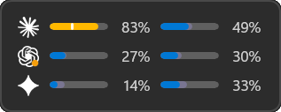
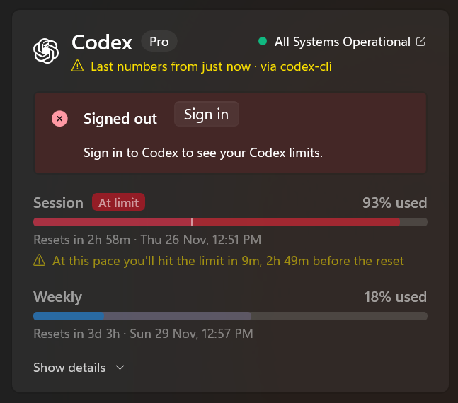
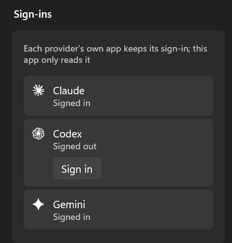

# AgentsWinBar

**Watch your Claude, Codex, and Gemini usage limits from the Windows 11 desktop, without opening a browser.**

AgentsWinBar is a free, open-source Windows 11 tray app for people who work with AI coding agents. It puts your remaining quota windows, reset times, service status, and local token cost estimates right where you work: a tray flyout, a taskbar strip, a floating overlay, and a full dashboard window.

Starting with **v1.6.0**, AgentsWinBar reads usage and local costs natively on Windows. No WSL virtual machine is needed: it sits around **17 MB** of private memory at idle (Task Manager's Memory column) and uses about **0.2 CPU seconds** per refresh (down from a 1.3 to 1.7 GB WSL VM and about 10 CPU seconds per refresh). [How this was measured](PERFORMANCE.md).

[](LICENSE.txt)
[](https://dotnet.microsoft.com/)
[](https://microsoft.github.io/microsoft-ui-xaml/)


*Left: the tray flyout. Right: a provider detail page with usage history charts. Bottom: the taskbar strip. All screenshots and animations in this README use the app's built-in sample data.*

## Quick install

**Requirements:** Windows 11 (build 22000+, x64 or ARM64) and a Windows sign-in for whichever providers you use (**Claude Code**, **Codex CLI or Windows app**, or **Antigravity** for Gemini). The .NET 10 runtime is bundled; WSL is not required.

### Recommended: run the installer script

```powershell
git clone https://github.com/thomasyuxizeng/AgentsWinBar.git
cd AgentsWinBar
powershell -NoProfile -ExecutionPolicy Bypass -File install.ps1
```

Pass `-DryRun` first if you want to preview the steps without changing anything, or point your AI coding agent at [INSTALL.md](INSTALL.md) (which documents all flags, exit codes, and update steps).

What `install.ps1` does:

1. Downloads the latest signed MSIX package and checksum file for your architecture (x64 or ARM64) and verifies the SHA256 hash and signature.
2. Installs Microsoft's **Windows App Runtime 1.8** if missing (Microsoft-signed, unelevated first).
3. Trusts the app's self-signed release certificate in `LocalMachine\TrustedPeople` (batched into at most one UAC prompt with the runtime if needed).
4. Installs and launches AgentsWinBar, then checks that your selected providers have Windows sign-ins present and reports initial usage status.

During install, Windows shows the certificate publisher **`CN=CodexBarWin OSS`** (kept from the app's earlier name so existing installations upgrade cleanly).

### Manual install from GitHub Releases

Download the MSIX for your architecture (`AgentsWinBar-<tag>-x64.msix` or `AgentsWinBar-<tag>-ARM64.msix`), the matching certificate (`AgentsWinBar-<tag>-Certificate.cer`), and optionally `AgentsWinBar-<tag>-checksums.sha256` from the [Releases](https://github.com/thomasyuxizeng/AgentsWinBar/releases) page, then run:

```powershell
# Trust the release certificate (run in an administrator PowerShell)
Import-Certificate -FilePath .\AgentsWinBar-<tag>-Certificate.cer -CertStoreLocation Cert:\LocalMachine\TrustedPeople

# Install the package (normal user PowerShell; use ARM64 if on ARM64)
Add-AppxPackage .\AgentsWinBar-<tag>-x64.msix
```

### Upgrading from CodexBarWin

Earlier versions of this app were called **CodexBarWin**. AgentsWinBar installs alongside it and automatically copies your existing settings, caches, usage history, cost ledger, and cost index on first launch (without changing or deleting the old files). Once you see your data in AgentsWinBar, remove the old app:

```powershell
Get-AppxPackage -Name CodexBarWin | Remove-AppxPackage
```

## Supported providers

AgentsWinBar reads the sign-ins that each provider's own Windows tool already maintains:

| Provider | How to sign in on Windows | Usage windows shown | Local cost logs |
|---|---|---|---|
| **Claude** | Sign in with Claude Code (`claude` or `claude auth login`) | 5-hour session, 7-day weekly, model-scoped weekly limits (such as Sonnet or Opus), Daily Routines | Yes (`%USERPROFILE%\.claude\projects`) |
| **Codex** | Sign in with the Windows Codex app or `codex login` (ChatGPT account; API-key-only sign-ins have no plan limits) | 5-hour session, 7-day weekly, extra limits including Codex Spark 5-hour and Weekly | Yes (`%USERPROFILE%\.codex\sessions` and `archived_sessions`, including `.jsonl.zst`) |
| **Gemini** | Sign in to Antigravity on Windows (desktop app or `agy`) | Gemini 5-hour, Gemini weekly, plus shared Claude and GPT 5-hour and weekly windows | No (no local logs) |

## Desktop surfaces

AgentsWinBar gives you four views of the same live data:

- **Tray flyout and detail pages:** Left-click the tray icon for one card per enabled provider showing session, weekly, and extra windows with reset times and service status. Click any card to open its detail page with 14-day burndown charts, 7/14/30-day cost breakdowns, top models, and an error log. Right-click the tray icon to toggle the overlay, open Settings, or quit.
- **Taskbar strip and floating overlay:** Compact two-bar-per-provider readouts that stay visible while you work and hide automatically whenever a fullscreen app is active. Both are off by default; turn either or both on in **Settings**. The strip sits at the taskbar's left end, or beside the system tray when Start is at the left end (Windows 10, or a left-aligned Windows 11 taskbar); **Settings > Taskbar display > Position** picks a side yourself. The overlay is borderless and draggable (its position is saved).
- **Dashboard:** Open it from the flyout footer or the taskbar strip's right-click menu. It is a resizable window with full screen (`F11`) and keep-on-top pinning.

| Floating overlay | Taskbar strip |
|:---:|:---:|
|  |  |
| Draggable always-on readout; right-click for details or to hide. | Same compact readout along the taskbar; right-click for details, dashboard, or to hide. |

### Smart bars, alerts, and reset animations

- **Color thresholds:** Usage bars turn **amber** at 75% and **red** at 90%.
- **Relevance-based compact bars:** On the overlay and taskbar strip, each provider shows its two most relevant windows instead of always repeating the same two: the window that changed in the last 30 minutes comes first, followed by one running 15+ points ahead of schedule, then 90%+, then at the limit (if a longer partner window is already used up, it replaces the shorter one).
- **Usage alerts:** Windows toast notifications (on by default, with a **Send test notification** button in Settings) fire once per window per situation and re-arm when the window resets: **using it fast** (projected to hit the limit at least 30 minutes before reset and 25+ points ahead of elapsed time), **nearly out** (90%+), and **limit reached** (100%). Extra windows are included, and an early-reset toast and chip appear if usage drops 10+ points before a scheduled reset.
- **Reset animation:** When a window resets, its bar plays a short ring, collapse, and glow animation, and the app refreshes 2 seconds after each known reset time (with a retry 15 seconds later). Controlled in Settings under **Reset animation** (default: **Off in battery saver**; also skipped when Windows animations are turned off).


### The dashboard


- **NEEDS ATTENTION:** Surfaces failed fetches, service incidents, limits reached or running ahead of pace, stale data, signed-out providers, and low or over-budget API credits (shows **All clear** in the toolbar when everything is fine).
- **Provider panels:** Plan name, freshness, live service status with incident text and an **Open status page** link (Claude, OpenAI, and Google Workspace Status for Gemini; grey means the status feed could not be read), all usage windows, pace warnings, and local cost totals. Click **Show details** for 30-day token mix and top models.
- **GRAPHS:** Compact burndown charts per provider (usage plotted against an even-use guide with a projection; shows "Collecting data" until two samples exist for the current window) plus a 30-day daily cost chart. Toggle any provider's charts from the header or Settings.
- **Diagnostics:** Collapsible bottom panel with effective settings, history store stats, cost scan status, and this session's refresh log and alerts.


## Local cost tracking and optional API panels

### Local log cost estimates (Claude and Codex)

When **Show cost and token totals** is enabled in Settings, AgentsWinBar scans your local Windows Claude Code and Codex JSONL session logs (including Zstandard-compressed `.jsonl.zst` Codex archives) and prices tokens at list rates. These totals are **list-price estimates from local logs, not your provider bill**.

- **Demand-driven scanning:** Cost scans run only while the flyout or dashboard is open (not minimized) or when you click **Refresh**, at most once every 30 minutes per provider, and never while the PC is locked.
- **Private local index:** Incremental scan state is stored in `cost-index\index.sqlite` inside the app data folder. It stores only hashed file paths, file offsets, model names, dates, token counts, and hash keys: no prompts, no raw file paths, and no message text.
- **Pricing and custom rates:** Prices are resolved in order from your optional `custom-pricing.json` (USD per million tokens, exact model key, `0` for free), historical pre-change rates, the `models.dev` catalog (refreshed at most once every 24 hours via a plain GET with no user data), and built-in tables ported from CodexBar.
- **Permanent ledger:** Daily cost and token totals persist in `cost-ledger.json` even after old session logs rotate away. Query lifetime or date-range totals anytime with:
  ```powershell
  powershell -ExecutionPolicy Bypass -File tools\cost-ledger-report.ps1
  ```

### Optional: Anthropic API credits

The dashboard's Claude panel can track your Anthropic organization's API spend against a monthly budget:

1. Open **Settings > Anthropic API credits** (or **Open Settings** on the dashboard's Claude panel) and click **Create an Admin key**. Only organization admins can create Admin keys.
2. Paste the key and click **Save key**. The app checks it with one read-only Admin API request, saves it to your user environment variable `ANTHROPIC_ADMIN_KEY`, and uses it right away. **Replace key** and **Remove key** work the same way, with no restart.
3. Set **Monthly budget (USD)** (default 200) and **Renewal day** (1 to 28, UTC; default 1), then click **Save**.

A key you already set in `ANTHROPIC_ADMIN_KEY` yourself is picked up as before.

It refreshes at most every 5 minutes only while the dashboard is visible, shows spend, remaining budget, daily pace, and a per-member **Used by** breakdown, and never writes the key or spend figures to disk. Without a key set, the section stays hidden unless you click **Show details** on the Claude panel.

### Optional: Gemini API spend

If you track your own Gemini API calls in a local JSON Lines log pointed to by the `CODEXBAR_GEMINI_SPEND_LOG` environment variable, the dashboard's Gemini panel sums the recorded dollar amounts for the current calendar month (local time), broken down by route and model. Each line is a JSON object with `time` (local timestamp without a timezone), `model`, optional `backend` (`aistudio` or `vertex`), and `usd` or `usd_cache_aware` (which takes precedence); the app reads only the last 8 MiB while the dashboard is visible and only when the file changes, and shows nothing if no log exists.

## Privacy, credentials, and network traffic

AgentsWinBar is built to read your quota cleanly and leave everything else alone.

### What it reads and what it never touches

- **Read-only sign-ins:** AgentsWinBar never creates, edits, or deletes any provider credential file or Windows Credential Manager entry. It reads only the default Windows profile (`CLAUDE_CONFIG_DIR` and `CODEX_HOME` are not used):
  - **Claude:** `%USERPROFILE%\.claude\.credentials.json`, reading only the `claudeAiOauth` object (all other keys are skipped unread).
  - **Codex:** `%USERPROFILE%\.codex\auth.json`, reading only the access token and account metadata (the refresh token is skipped unread; `OPENAI_API_KEY` is only checked for presence).
  - **Gemini:** Windows Credential Manager generic credential `gemini:antigravity` via read-only `CredReadW` (refresh tokens and client secrets are never read).
- **Memory-only tokens:** Provider access tokens are held only in memory in buffers zeroed after use, and `ANTHROPIC_ADMIN_KEY` is read from the environment on each use without being saved in state; none of them are logged, printed, or written to disk. The only place the app writes the Admin key is that user environment variable, when you save it in Settings.
- **No telemetry:** There is no analytics, telemetry, or external crash-reporting service. Release builds keep two small local logs, `app.log` (warnings) and `crash.log` (unexpected errors), each capped at 1 MB.
- **Logs stay local:** Nothing from your session logs, prompts, or cost totals ever leaves your PC.

### Automatic sign-in renewal and signed-out state

When an existing sign-in expires, AgentsWinBar keeps displaying your last good reading (marked stale) rather than flashing an error banner. For **Claude** and **Gemini**, it can ask the provider's own CLI to renew an expired token in the background (hidden, with command output discarded unread; at most once every 30 minutes, backing off to every 2 and then 6 hours while renewal keeps failing):

- **Claude:** runs `claude auth status` (`claude.exe auth status --json`).
- **Gemini:** runs `agy models` (lists models, uses no quota, about 1.7 CPU seconds).
- **Codex:** has no automatic renewal; open Codex on Windows to renew an expired sign-in.

You can turn automatic renewal off per provider in `settings.json` (`renewClaudeSignIn` / `renewGeminiSignIn`).

If a provider is **signed out** (missing or rejected with HTTP 401/403), the dashboard panel, detail page, and **Settings > Sign-ins** show a red **Signed out** banner with a **Sign in** button and dim last-known numbers. Clicking **Sign in** opens the provider's official login (`claude auth login`, `codex login`, or Antigravity) and watches for the updated sign-in so your numbers appear right after you finish.

| Dashboard signed-out banner | Settings > Sign-ins |
|:---:|:---:|
|  |  |

### Everything that leaves your machine

All outbound requests use HTTPS only, a strict host allow list, no redirects, and no cookies:

| Destination | When | What is sent |
|---|---|---|
| `api.anthropic.com/api/oauth/usage` | Claude usage refresh (cached in memory 9.5 min; backs off at least 10 min on HTTP 429) | Claude Bearer token, `anthropic-beta` header, `User-Agent: claude-code/2.1.0` |
| `chatgpt.com/backend-api/wham/usage` | Codex usage refresh | Codex Bearer token, `ChatGPT-Account-Id` when present, `User-Agent: CodexBar` |
| `cloudcode-pa.googleapis.com` and `daily-cloudcode-pa.googleapis.com` | Gemini usage refresh (never onboards an account) | Antigravity Bearer token, fixed quota query body, `User-Agent: antigravity/hub/2.9.1 linux/amd64` |
| `status.claude.com`, `status.openai.com`, `www.google.com/appsstatus` | With refreshes, at most once every 5 min per provider | Plain GET, no credentials |
| `models.dev/api.json` | At most once every 24 h while cost tracking is enabled | Plain GET, no user data |
| `api.anthropic.com/v1/organizations/...` | Only if `ANTHROPIC_ADMIN_KEY` is set and the dashboard is visible (at most every 5 min); one key check when you save a key in Settings or open Settings with a key set | `x-api-key` Admin key |

The three usage endpoints identify as each provider's own client family (`claude-code`, `CodexBar`, `antigravity/hub`) because those endpoints only accept requests from those clients.

## Performance and battery

AgentsWinBar is designed to stay out of the way on laptops:

- **Default refresh:** Usage refreshes every **5 minutes** by default (configurable in Settings to 1, 2, 5, or 10 minutes).
- **Adaptive backoff:** On by default (`adaptiveRefreshEnabled`). After two unchanged refreshes the delay doubles; after four it triples, capped at 15 minutes.
- **Battery saver:** Doubles the refresh delay (up to 30 minutes) and disables the reset animation under the default setting.
- **Locked PC and minimized dashboard:** While locked, refreshes wait at least 30 minutes (`lockedRefreshIntervalMinutes`) and cost scans and API credit polls pause. Minimizing the dashboard stops its clock and cost demand.
- **Offline resilience:** Last-known usage is kept in memory for transient errors, rate limits, or expired tokens, and restored as stale from `cache.json` on startup (dropped after 7 days). Usage history is kept for 14 days; cost caches and the daily ledger are kept indefinitely.

## Configuration, data folder, and optional WSL fallback

For the packaged MSIX app, data lives in:

```text
%LOCALAPPDATA%\Packages\AgentsWinBar_w05y65rx3mcz6\LocalCache\Local\AgentsWinBar\
```

Quit the app from the tray menu before editing `settings.json` by hand. Notable files in that folder:

- `settings.json` (saved atomically; malformed values recover to defaults)
- `cache.json`, `usage-history.json`, `claude-cooldown.json`, `early-resets.json`, `alerts-sent.json` (which usage alerts were already shown, so a restart doesn't repeat them)
- `cost-cache.json`, `cost-ledger.json`, `cost-index\index.sqlite`, `model-prices.json`, optional `custom-pricing.json`
- `app.log` and `crash.log` (local warning and error logs, 1 MB each; they record exception types and stack frames, never exception messages, file paths or process output; read them before sharing)

Options available only in `settings.json` (no Settings UI toggle): `renewClaudeSignIn` (default `true`), `renewGeminiSignIn` (default `true`), `adaptiveRefreshEnabled` (default `true`), `lockedRefreshIntervalMinutes` (default `30`), `usageSources`, and `costSource`.

**Optional WSL fallback:** If you ever need the older WSL + CodexBar CLI route for a provider, set `"usageSources": { "<provider>": "wsl" }` (and optionally `"costSource": "wsl"`) in `settings.json` and run `install.ps1 -WithWsl`. See [INSTALL.md](INSTALL.md) for details; native Windows is recommended for everyone else.

## Troubleshooting

- **Provider says "Signed out":** Click **Sign in** on the dashboard or in **Settings > Sign-ins**, or sign in directly on Windows (`claude`, `codex login` or the Codex app, or Antigravity). For Codex, plan limits require a ChatGPT login rather than an API-key-only `auth.json`.
- **Stale numbers / "Expired, waiting for ... to renew it":** For Claude and Gemini, automatic renewal runs at most every 30 minutes as long as `claude.exe` (on `PATH` or `%USERPROFILE%\.local\bin`) or `agy.exe` (on `PATH` or WinGet links) is installed. For Codex, open Codex on Windows. Opening any provider's own app renews its sign-in immediately.
- **Claude says rate limited:** Anthropic rate-limits the OAuth usage endpoint. AgentsWinBar keeps showing your last good numbers and backs off for at least 10 minutes (persisted across restarts in `claude-cooldown.json`).
- **Data is not refreshing:** Confirm **Developer mode** is turned off in Settings (it shows sample data and stops all fetches). Check your network, **Settings > Sign-ins**, and the dashboard's **Diagnostics** panel. Remember that adaptive backoff (up to 15 min) and battery saver (up to 30 min) space out idle refreshes.
- **No cost totals shown:** Confirm **Show cost and token totals** is enabled in Settings, open the flyout or dashboard to trigger a scan, and check that Windows logs exist in `%USERPROFILE%\.claude\projects` or `%USERPROFILE%\.codex\sessions`. Gemini has no local logs.
- **Install fails with `0x800B0109` or "The app package must be signed":** The release certificate (`CN=CodexBarWin OSS`) is not trusted in `LocalMachine\TrustedPeople`. Run `install.ps1` or import the release `.cer` from an administrator PowerShell.
- **"Part of this app has been blocked" on a local build:** Windows App Control policies (such as Smart App Control) can block an unsigned `AgentsWinBar.exe` run from `bin\`. Install a signed MSIX package instead.
- **Launching the app again does nothing:** AgentsWinBar runs as a single instance; check the system tray (including the `^` overflow menu). If it exited silently on startup, check `crash.log` in the data folder.
- **Resetting settings or uninstalling:** Quit the app and delete `settings.json` to reset preferences (or delete `cost-index` to rebuild the cost index). To uninstall, use **Settings > Apps > Installed apps > AgentsWinBar > Uninstall** or run `Get-AppxPackage -Name AgentsWinBar | Remove-AppxPackage`. Shared runtimes, provider tools, and sign-ins are untouched; optionally remove `%LOCALAPPDATA%\AgentsWinBar-Setup` and any leftover files in the app data folder.

## Development

Built with **.NET 10**, **WinUI 3** (Windows App SDK 1.8), **CommunityToolkit.Mvvm**, **H.NotifyIcon.WinUI**, and **MSTest**.

```powershell
dotnet restore AgentsWinBar.sln
dotnet build AgentsWinBar.csproj -c Release -p:Platform=x64 -p:PublishReadyToRun=false
dotnet test AgentsWinBar.Tests.Unit -c Debug -p:Platform=x64
```

New files under `Services/`, `Models/`, and `Helpers/` must be linked into the unit test project. To package a signed MSIX locally, create a self-signed code-signing certificate with subject `CN=CodexBarWin OSS`, trust it in `LocalMachine\TrustedPeople`, bump `Identity Version` in `Package.appxmanifest`, build the sideload MSIX, and sign it with Windows SDK `signtool`.

- [Install guide for AI agents](INSTALL.md)
- [Performance: how memory and CPU were measured](PERFORMANCE.md)
- [Changelog](CHANGELOG.md)
- [Contributing guidelines](CONTRIBUTING.md)
- [Security policy](SECURITY.md)
- [Code of conduct](CODE_OF_CONDUCT.md)
- [Third-party notices](THIRD-PARTY-NOTICES.md)

## Credits and license

AgentsWinBar grew out of [nek0der/CodexBarWin](https://github.com/nek0der/CodexBarWin) (MIT), which brought [Peter Steinberger's CodexBar](https://github.com/steipete/CodexBar) (MIT) to Windows. Huge thanks to both projects: AgentsWinBar's native Windows usage readers and built-in pricing tables are ported from CodexBar, and live model pricing comes from [models.dev](https://models.dev) (MIT).

AgentsWinBar is an independent open-source project and is not affiliated with Anthropic, OpenAI, or Google.

Licensed under the [MIT License](LICENSE.txt). Third-party package licenses are tracked in [THIRD-PARTY-NOTICES.md](THIRD-PARTY-NOTICES.md) and checked in CI.
