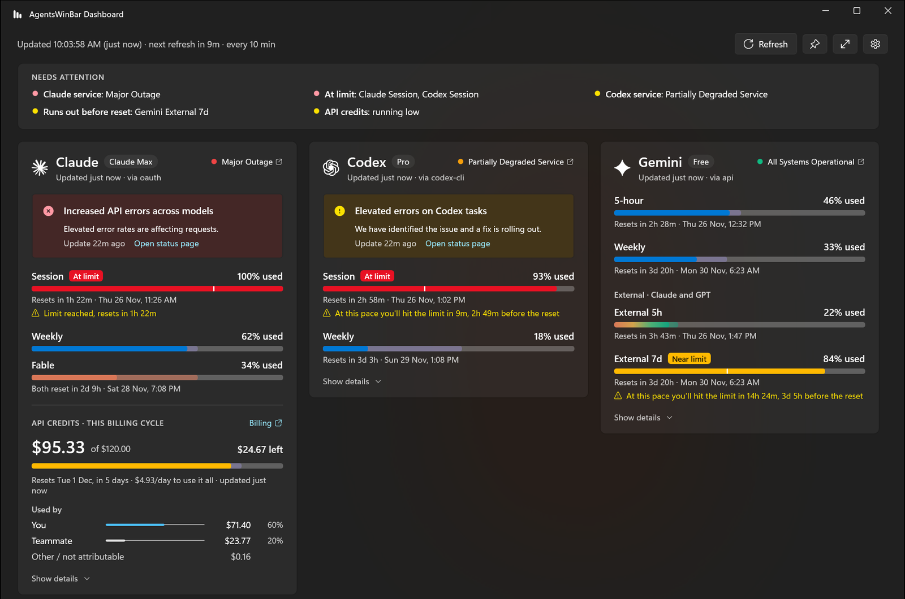
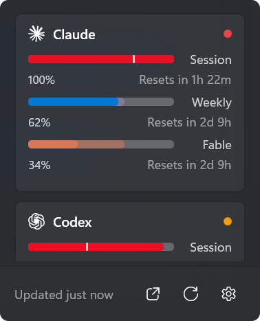

# CodexBarWin

**See how much of your Claude, Codex and Gemini limits you have left, without opening anything.**

A Windows 11 app that puts your AI coding usage on the desktop: a tray flyout, an always-on floating readout, a strip that sits on the taskbar, and a full dashboard that shows every limit at once. It reads the numbers from the [CodexBar CLI](https://github.com/steipete/CodexBar) running in WSL.

This is the Wave-OCE fork of [nek0der/CodexBarWin](https://github.com/nek0der/CodexBarWin), which is the Windows front end for [steipete/CodexBar](https://github.com/steipete/CodexBar). What changed in the fork is [listed below](#what-this-fork-adds).

## Install

Tell your AI coding agent: `Install CodexBarWin from https://github.com/Wave-OCE/CodexBarWin — follow INSTALL.md`. Or run `powershell -ExecutionPolicy Bypass -File install.ps1` from a clone. See [INSTALL.md](INSTALL.md) for commands and exit codes.

[](LICENSE.txt)
[](https://dotnet.microsoft.com/)
[](https://microsoft.github.io/microsoft-ui-xaml/)


*Left: the tray flyout. Right: a provider's detail page (Gemini, showing Antigravity's separate Claude and GPT quota). Bottom: the taskbar strip.*



*The dashboard: headline tiles, every usage bar on one screen, then a detailed panel per provider.*

## Contents

- [What you get](#what-you-get)
- [Quick start](#quick-start)
- [Reading the bars](#reading-the-bars)
- [The dashboard](#the-dashboard)
- [What this fork adds](#what-this-fork-adds)
- [How it works](#how-it-works)
- [Troubleshooting](#troubleshooting)
- [Configuration](#configuration)
- [Development](#development)

## What you get

| | |
|---|---|
| **Flyout** | Click the tray icon (or the strip, or the overlay) for a card per provider: session, weekly and extra windows, with exact reset times. Click a card for its detail page. |
| **Dashboard** | A full, resizable window (full screen with F11, optional keep-on-top) opened from the button in the flyout footer. See [The dashboard](#the-dashboard). |
| **Taskbar strip** | A compact, borderless strip flush with the left end of the taskbar: provider logo plus two bars each. Always visible, never takes focus. |
| **Floating overlay** | The same readout as a small draggable window that stays above your apps. Position is remembered. |
| **Usage alerts** | Windows notifications when you're burning through a limit too fast, nearly out, or out. |
| **Pace awareness** | Every bar also shows how much of the window's time has passed, so you can tell "50% used" at the start of a window from "50% used" near the end. |
| **Provider status** | Service health on each card, incident details with a status-page link, and a small incident dot on compact displays. Grey means no status is available (including Gemini through Antigravity). |
| **Cost and tokens** | Today's and last-30-days totals from local logs, each on its own wrapping card line. Detail pages show daily costs and top models. Amounts are list-price estimates, not bills. |
| **Usage history** | Detail pages plot each limit window's usage against an even-use guide readable in light and dark themes, with a projection from the observed rate and local capture times. History builds as the app runs and is kept for 14 days. |

Supported providers: **Claude**, **Codex** (OpenAI) and **Gemini** (read through Google's Antigravity).

The two compact displays, which you can run together or separately:

| Floating overlay | Taskbar strip |
|:---:|:---:|
|  |  |
| Rows are Claude, Codex and Gemini; each row shows two bars. | The same readout laid out along the taskbar. |

## Quick start

`install.ps1` automates steps 1–4 below; see [INSTALL.md](INSTALL.md).

You need about 15 minutes the first time. The app runs on Windows; the usage data comes from a small tool inside WSL, so there are three parts: WSL, sign-ins, then the app.

### 1. Prerequisites

- **Windows 11.** The app is built and tested on it; the taskbar strip and Mica backdrop are designed for it.
- **WSL 2 with Ubuntu.** From an administrator PowerShell: `wsl --install -d Ubuntu-24.04`, then restart. If that fails, see [WSL won't install](#wsl-wont-install).
- To build the app yourself you also need the **.NET 10 SDK**. If you install a prebuilt package you don't.

### 2. Set up the CLI inside WSL

Clone this repo, then from PowerShell in `tools\wsl`:

```powershell
git clone https://github.com/Wave-OCE/CodexBarWin.git
cd CodexBarWin\tools\wsl
.\install-wsl-shim.ps1 -Distro Ubuntu-24.04
```

This downloads the CodexBar CLI (checksum verified), installs it in `/opt/codexbar`, and installs a small wrapper (the "shim") that makes Claude and Gemini work reliably. Details in [tools/wsl/README.md](tools/wsl/README.md).

### 3. Sign in to each provider (once, inside WSL)

Open a WSL shell (`wsl -d Ubuntu-24.04`) and sign in to the providers you use:

| Provider | Steps |
|----------|-------|
| **Claude** | Run `claude` and log in with your Claude account. |
| **Codex** | `npm install -g @openai/codex`, then `codex login` (use `codex login --device-auth` if the browser redirect doesn't reach WSL). It needs its own Linux copy; a Windows `codex` can't run in WSL. |
| **Gemini** | `curl -fsSL https://antigravity.google/cli/install.sh \| bash`, run `agy` once and sign in with Google, then exit straight away (it is an agent and will act on anything you type). |

Check that it works: `wsl -d Ubuntu-24.04 codexbar usage --provider claude --format json` should print JSON.

### 4. Install the app

The app is a signed MSIX package. The signature is self-signed, so Windows needs to trust the certificate once.

**From a release** (when one is published):

```powershell
gh release download --repo Wave-OCE/CodexBarWin --pattern "*.msix" --pattern "*.cer"

# Trust the certificate (administrator PowerShell)
Import-Certificate -FilePath .\CodexBarWin-v*-Certificate.cer -CertStoreLocation Cert:\LocalMachine\TrustedPeople

# Install
Add-AppxPackage .\CodexBarWin-v*-x64.msix
```

Don't use `CodexBarWin.appinstaller`: it still points at the upstream project's releases and would install (and keep updating to) the upstream app, without the changes listed below.

**From source:**

```powershell
# One-time: a signing certificate whose subject matches the manifest publisher
$cert = New-SelfSignedCertificate -Type CodeSigningCert -Subject "CN=CodexBarWin OSS" `
  -KeyUsage DigitalSignature -CertStoreLocation Cert:\CurrentUser\My `
  -TextExtension @("2.5.29.37={text}1.3.6.1.5.5.7.3.3", "2.5.29.19={text}")
Export-Certificate -Cert $cert -FilePath CodexBarWin.cer
Import-Certificate -FilePath CodexBarWin.cer -CertStoreLocation Cert:\LocalMachine\TrustedPeople   # admin

# Build the package, sign it, install it
# First set Identity Version in Package.appxmanifest to your chosen version, e.g. 0.9.6.0
dotnet build CodexBarWin.csproj -c Release -p:Platform=x64 -p:UapAppxPackageBuildMode=SideloadOnly `
  -p:AppxBundle=Never -p:AppxPackageDir="AppPackages\" -p:AppxPackageSigningEnabled=false `
  -p:GenerateAppxPackageOnBuild=true -p:PublishReadyToRun=false
signtool sign /fd SHA256 /sha1 $cert.Thumbprint (Get-ChildItem AppPackages -Filter *.msix -Recurse).FullName
Add-AppxPackage (Get-ChildItem AppPackages -Filter *.msix -Recurse).FullName
```

`signtool` ships with the Windows SDK. Increase the manifest's Identity Version for each build so Windows
treats it as an update; `AppxVersion` alone did not override the manifest in the tested .NET SDK build.
Choose the MSIX for that version when signing and installing if `AppPackages` contains older builds.
The packaged app keeps its settings across updates.

> **Running an unsigned build** (`dotnet run`, or the exe from `bin\`) is blocked on machines with Smart App Control or App Control for Business enabled. Install the signed package instead.

### 5. Use it

1. Launch **CodexBarWin** from the Start menu. It lives in the system tray (it may be under the `^` overflow).
2. Click the tray icon for the flyout. Click a provider card for details, the gear for **Settings**, or the dashboard button in the footer for the [full dashboard](#the-dashboard).
3. In **Settings**, turn on what you want:


| Setting | What it does |
|---------|--------------|
| Providers | Choose which providers show, and their order. Changes apply immediately. |
| Refresh interval | How often usage is fetched (1, 2, 5 or 10 minutes). While your usage isn't changing the app waits longer (up to 3x, capped at 15 minutes) and returns to this interval as soon as something moves, or when you open the flyout or dashboard and the data is older than the refresh interval. Turn this off with `adaptiveRefreshEnabled` ([Configuration](#configuration)). |
| Always-on overlay | The floating readout. Drag to move, right-click for options. |
| Taskbar display | The strip on the taskbar, bottom-left corner. |
| Usage alerts | Windows notifications. "Send test notification" checks they reach you. |
| Show cost and token totals | Local log estimates on cards and detail pages. Scans run while the flyout or dashboard is open (at most every 30 minutes) and when you click Refresh. |
| Run at startup | Start with Windows. |

Both compact displays hide themselves while a fullscreen game, video or presentation is running.

## Reading the bars

Every bar has up to three layers:

| You see | It means |
|---------|----------|
| **Blue** fill | Usage so far in this window. |
| **Lavender** behind it | How much of the window's time has passed. Lavender sticking out past the blue means you're using the window slowly. |
| **White marker line** | Only appears when you're *ahead* of schedule (blue has passed the time position): you're using it faster than the window refills. |
| **Amber** (80%+), **red** (95%+) | Getting close to the limit. These override every other colour. |

Hover any bar for the exact numbers and a projection, for example *"At this pace you'll hit the limit in 1h 20m, 3h 10m before the reset"*.

Extra windows have their own colours so they stand apart from the main session and weekly bars:

| Colour | Window |
|--------|--------|
| Anthropic orange | Claude windows, such as Claude's **Fable** limit. |
| OpenAI green | OpenAI windows. |
| Orange to green gradient | Antigravity's shared **External** quota (5h and 7d: Claude and GPT models), shown on Gemini's card. |



On the floating overlay and the taskbar strip, each provider shows its two most **relevant** bars rather than always session and weekly. In order: the bar that moved most recently (last 30 minutes), then a window running ahead of schedule, then one near its limit (90%+), then one at its limit. Windows at or near a limit rank last on purpose: if you can't use more of it anyway, you'd rather see what you still have.

### Alerts

One notification per usage window (re-armed when the window resets), at three levels: **far ahead of pace** (25+ points ahead and the limit would be hit well before the reset), **nearly out** (90%+), and **at the limit**. They cover the extra windows too.

## The dashboard

The flyout is for a quick look; the dashboard is for when you want the whole picture. Click the dashboard button in the flyout footer (or reopen it the same way; a minimized dashboard is restored). It is a normal window: resize it, maximize it, press **F11** for full screen (Esc leaves it), or pin it on top with the pin button. Refresh runs a fetch right away, and the window follows the app's refresh interval otherwise.

From top to bottom:

| Section | What it shows |
|---------|---------------|
| **Headline tiles** | Provider health, service incidents, how many limits are at or near their cap and how many are ahead of pace, the most-used window, the next reset, and cost today and over 30 days. |
| **Usage overview** | One card per provider with a one-line bar for every window (name, bar with its pace layer, percent used, time to reset). Every limit is visible on load without scrolling. Hover a row for the exact numbers. |
| **Provider panels** | A detailed panel per provider: every usage window with reset time, pace projection and a usage history chart; service status; cost and token totals with daily cost bars; top models. Gemini gets a full-width panel with its own models and the External (Claude and GPT) pool side by side. |
| **Diagnostics** | Always at the bottom, also in full screen: CLI and app versions, the effective settings, the history store, cost scans, and this session's refresh log and alerts. |

Refreshes only redraw what changed, so scrolling stays smooth while data loads.

## What this fork adds

Compared with upstream, this fork adds:

- **A dashboard window** with headline tiles, a usage overview with every bar at once, a detailed panel per provider and a diagnostics section. See [The dashboard](#the-dashboard).
- **Always-on overlay and taskbar strip.** Borderless, rounded where it should be, flush with the taskbar, never steals focus, and hides during fullscreen apps.
- **A flyout that reliably appears over other programs**, instead of sometimes opening behind them.
- **Pace layer, marker and run-out projections** on every bar.
- **Usage alerts** as Windows notifications, with a test button.
- **Provider service status badges** with incident details and status-page links. The overlay and taskbar logos show a dot only for reported incidents or maintenance.
- **Estimated cost and token totals**, with Windows log discovery for Claude and Codex, daily cost bars and top models. Optional in Settings; never shown on the compact displays.
- **Usage history charts** for session, weekly and extra windows, with an even-use guide, observed-rate projection, capture time and sample count. Snapshots are kept locally for 14 days; charts show "Collecting data" until two current-window samples have been captured.
- **Codex support**, and **provider logos** in place of text labels on the compact displays.
- **Extra windows**: Claude's Fable limit, and Antigravity's External (Claude and GPT) quota under Gemini, on the flyout cards and detail page, in provider colours.
- **Relevance-based bar selection** on the compact displays.
- **A working Gemini.** Google shut down the Gemini CLI login for individual accounts, so Gemini is read from Antigravity and shown as 5-hour and weekly windows.
- **Reliable Claude.** The OAuth usage endpoint is rate limited by Anthropic ("Command failed (exit code 3)"), and the CLI route became slow. The shim now uses OAuth first with a cooldown, falls back to the CLI, caches for 10 minutes and shows the last good result on failure.
- **No more hidden 30-second cap** on WSL commands, which was the cause of "Command timed out after 30 seconds".
- **Providers apply immediately** when enabled, disabled or reordered in Settings.
- **Safer settings and refreshes.** Settings saves replace a complete file atomically, failed saves show a visible error and restore uncommitted values, and malformed values recover to defaults. Canceled refreshes cannot put old results back on screen. Quit flushes history before exiting.
- **`tools/wsl`**: one-step setup for the CLI and shim.
- Close to 500 unit tests, including settings persistence, refresh cancellation races and cost-cache recovery after cancellation.

The full list is in the [changelog](CHANGELOG.md).

## How it works

```
CodexBarWin (WinUI 3)  ->  wsl.exe  ->  codexbar shim  ->  CodexBar CLI  ->  Claude / Codex / Antigravity
```

The app runs `codexbar usage --provider <id> --format json` inside your WSL distro on a timer and draws the result. The shim sits in front of the real CLI and handles the provider-specific problems (Gemini via Antigravity, Claude rate limits and caching); everything else passes straight through. WSL itself shuts down when idle, which is why nothing in WSL can run as a background process: each refresh starts the command fresh.

## Troubleshooting

### Claude shows an error or old numbers

Anthropic rate limits the usage endpoint. The shim backs off for 10 minutes and shows the last good result. If it shows an error with no numbers at all, run `claude` in WSL once to confirm you're signed in. Test the shim directly: `wsl -d Ubuntu-24.04 codexbar usage --provider claude --format json --source cli`.

### "Command timed out after N seconds"

The limit is the larger of `wslCommandTimeoutSeconds` and the provider timeouts in [settings.json](#configuration). A cold WSL start plus a slow provider can still exceed it; raise `cliProviderFirstFetchTimeoutSeconds`.

### A provider is missing

Enable it in Settings, Providers. Codex and Gemini also need their sign-in from [step 3](#3-sign-in-to-each-provider-once-inside-wsl).

### "Part of this app has been blocked" / the app won't start

That's Smart App Control or App Control for Business rejecting an unsigned build. Install the signed MSIX ([step 4](#4-install-the-app)). The app's crash log is at `%LOCALAPPDATA%\CodexBarWin\crash.log`.

### "The app package must be signed" or error `0x800B0109`

The signing certificate isn't in **Trusted People** on the *Local Machine* store, or the certificate you trusted isn't the one that signed the package (releases from 1.0.0 share one certificate; earlier releases each had their own, so trust the `.cer` that came with that release). `install.ps1` handles this for you. Compare thumbprints: `Get-AuthenticodeSignature .\CodexBarWin.msix`.

### WSL won't install

If `wsl --install` fails with a network error, install the distro from the Microsoft Store or with `winget install Canonical.Ubuntu.2404`, then run `ubuntu2404.exe install --root`.

### Data not refreshing

Check `wsl --status`, then run the CLI by hand (see [step 3](#3-sign-in-to-each-provider-once-inside-wsl)). If that works, check the refresh interval in Settings.

### Uninstall

**Settings, Apps, Installed apps, CodexBarWin, Uninstall.** To remove the WSL side, delete `/opt/codexbar` and `/usr/local/bin/codexbar` inside the distro. To keep the CLI but drop the shim: `ln -sf /opt/codexbar/CodexBarCLI /usr/local/bin/codexbar`.

## Configuration

Settings live in `settings.json`. For the packaged app it is under `%LOCALAPPDATA%\Packages\CodexBarWin_w05y65rx3mcz6\LocalCache\Local\CodexBarWin\`. Edit it with the app closed.

```json
{
  "refreshIntervalSeconds": 300,
  "adaptiveRefreshEnabled": true,
  "alwaysOnOverlayEnabled": false,
  "taskbarDisplayEnabled": true,
  "alertsEnabled": true,
  "timeouts": {
    "wslCommandTimeoutSeconds": 30,
    "cliProviderFirstFetchTimeoutSeconds": 60,
    "cliProviderTimeoutSeconds": 45
  }
}
```

`wslCommandTimeoutSeconds` is a minimum: it is never allowed to be shorter than the provider timeouts.

Cost and token totals are enabled by default (`showCostTotals`). They read Windows Claude/Codex logs when
available, or WSL home logs otherwise; Gemini cost reads Antigravity's WSL logs. The shim must be updated
for cost support: its older Claude cache also intercepted cost commands. Amounts are list-price estimates
and can omit unpriced or unmetered activity.

The last complete totals per provider are kept in `cost-cache.json` beside `settings.json` and shown straight
away at startup. A scan that fails or times out keeps showing them, and only a newer complete scan replaces
them (results older than 7 days are dropped; "today" resets once that day has passed). Scans can take a
while when logs are large, so each one gets up to 5 minutes.

Usage snapshots live in `usage-history.json` beside `settings.json`. The app records a sample when usage
changes by at least half a percentage point, ten minutes pass, or a limit window resets. Each chart shows
only the current window; old-window samples remain on disk until the 14-day retention period expires.

### Keeping WSL light

Each refresh starts the WSL VM, which by default can claim up to half your RAM and gives memory back slowly.
A `%USERPROFILE%\.wslconfig` keeps it small and shuts it down 10 seconds after the last command instead of a minute (apply with `wsl --shutdown`):

```ini
[wsl2]
memory=4GB
vmIdleTimeout=10000

[experimental]
autoMemoryReclaim=gradual
```

## Development

```powershell
dotnet restore CodexBarWin.sln
dotnet build CodexBarWin.csproj -c Release -p:Platform=x64 -p:PublishReadyToRun=false
dotnet test CodexBarWin.Tests.Unit -c Debug -p:Platform=x64
```

Stack: .NET 10, WinUI 3 (Windows App SDK 1.8), MVVM with CommunityToolkit, H.NotifyIcon, MSTest. Pure logic (pace, alerts, bar selection, formatting) is covered by unit tests; new files in `Services/`, `Models/` and `Helpers/` need tests and must be linked into the test project.

Releases are built by [`release.yml`](.github/workflows/release.yml): push a tag like `v0.9.6` and CI builds, signs and publishes the MSIX and certificate.

- [Contributing guidelines](CONTRIBUTING.md)
- [Changelog](CHANGELOG.md)
- [Security policy](SECURITY.md)
- [Code of conduct](CODE_OF_CONDUCT.md)

## Credits and license

Built on [nek0der/CodexBarWin](https://github.com/nek0der/CodexBarWin) and the [CodexBar](https://github.com/steipete/CodexBar) CLI by Peter Steinberger. MIT licensed, see [LICENSE.txt](LICENSE.txt). Third-party licenses are checked in CI.
